å# Born Another

**MC2994 Procedural World Building — Project 03**
Semester start through midterm (September–mid-October 2026)

This file is the project README. The course folder also contains **Noise Lab** (`../Project02`), which came first. Both are described here so the work can be understood without opening every other note.

The semester moved from **noise as an instrument** to **life as a finite procedural system**.

1. **Noise Lab** — one curl-noise field drives a map, a terrain, simulations, and a voxel volume.
2. **Born Another** — the user sets conditions for an artificial digital life that develops, dies, and can leave a trace.

The course-level map (folder tree, both run commands, both file maps) is also in the [repository README](../README.md).

---

## Run this project

```bash
cd Project03_Born-Another
npm install
npm run dev
```

Open the Vite URL (usually `http://localhost:5173` or `5174`).

| Section | Hash | What it is |
| --- | --- | --- |
| **Concept** | `#concept` | Editorial statement of intent |
| **Studies** | `#shader`, `#scatter`, `#path`, `#particle`, `#explore`, `#lsystem`, `#material` | Technical studies on one shared organism |
| **System** | `#system` | Architecture and crystal-growth diagrams |
| **World** | `#world` | Explorable organism-world with a Life Engine |

`+ Parameters` opens the overlay. **Animate** / Space advances AGE. **Seed** locks identity.

To run Noise Lab instead: `cd ../Project02 && npm install && npm run dev`, then `#/2d`, `#/3d`, `#/sim`, `#/voxel`.

---

# 1. Noise Lab (what came first)

**Folder:** `Project02/`

Noise Lab is a **curl-noise instrument**. A single 2D field is generated from noise; that same field is read as a height map, as flow arrows, as a simulation domain, and later as a density volume. The UI is a technical poster: black field, white type, sparse accent (`../STYLE-GUIDE.md`).

### Research

The first half of the semester treated procedural form as a **map**, not as a finished sculpture.

**Noise as a function of position.** Simplex, Perlin, Worley, value noise, and FBM are interchangeable sources. They are not painted textures; they are sampled at every grid cell.

**Shaping after the sample.** Power, bias, gain, clamp, absolute, smoothstep, and sine remap the raw field so ridges, terraces, or cells can appear without writing a new noise type.

**Curl of a scalar potential.** A potential \(\psi\) is sampled; finite differences produce \((\partial\psi/\partial y,\; -\partial\psi/\partial x)\). That vector field is divergence-free, so it can be drawn as ticks and used as wind or particle advection.

**One field, several readings.** Height blends curl magnitude with remapped potential. The 2D viewport, the 3D mesh, and the simulation all consume the same arrays. SCALE, OCTAVES, STRENGTH, EVOLVE, resolution, and shaping update every view together.

**Simulation on the field.** Wind evolves the potential in time. Particles follow curl. Raindrop erosion carves a copy of the height. These are readings of the map, not a second world.

**Volume versus heightfield.** A height map cannot make caves or overhangs. The Voxel tab samples a 3D density function (ground / island / planet modes, CSG, meshing) so the same ideas — noise, threshold, combination — move from a surface into a solid.

**Shaders as a way of seeing.** Terrain studies practiced flat color, height gradients, interpolation, slope, Fresnel, and GPU vertex displacement. Those GLSL habits later shade the living membrane.

### Features that were built

| Route | What it does |
| --- | --- |
| `#/` Home | Enter screen: “A shared 2D field drives the map, the terrain, and the simulation.” |
| `#/2d` 2D MAP | Magnitude, potential, flow ticks, equation panel, shared noise / shaping / grid sliders |
| `#/3d` 3D WORLD | Same map sampled onto a plane (height + lateral curl). SOLID / WIREFRAME / SOLID + WIREFRAME. Optional floating 2D map |
| `#/sim` SIMULATION | Wind, particles (trails, 2D/3D), erosion. Start / pause / reset. Noise parameters stay live |
| `#/voxel` VOXEL | Density grid, threshold, FBM, CSG presets, meshers — independently tunable from the curl heightfield |

Also: terrain export (PNG / OBJ / GLTF / GLB), and optional Firebase (auth, save/load of the parameter set, Storage for exports). Runtime arrays and particles are rebuilt from saved settings, not stored.

### Main files

| Path | Role |
| --- | --- |
| `Project02/src/App.jsx` | Routing, shared params, noise map, simulation loop |
| `src/noise/generateNoiseMap.js` | Potential → shaping → curl → height |
| `src/noise/noiseTypes.js`, `shaping.js` | Kernels and remap ops |
| `src/pages/Map2DPage.jsx`, `Grid3DPage.jsx`, `SimulationPage.jsx`, `VoxelPage.jsx` | The four instruments |
| `src/simulation/` | Particles, raindrops, erosion, rAF |
| `src/voxel/` | Density, chunks, CSG, mesh |
| `src/export/exportTerrain.js` | Downloads |
| `src/firebase.js`, `src/services/` | Auth and saved configs |

### What carried forward

- A parameterized field is the identity of the world.
- Rest / 2D data can drive 3D form (later: scatter, paths, veins on a sphere).
- Particles and curl are readings of a field (later: currents on the organism).
- Shaders displace and color from uniforms rather than baking a look.

Noise Lab still produces a **world you keep adjusting**. Born Another changes the contract: the user no longer owns a terrain; they observe a life that will end.

---

# 2. Born Another (current project)

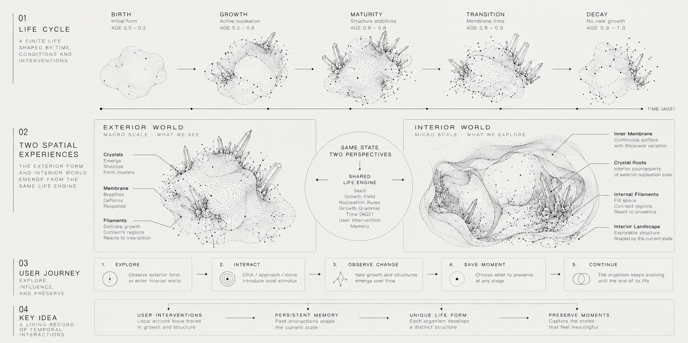

### Concept

Most generative tools ask for a preferred output: set parameters, generate an object, keep the one you like.

Born Another treats the generated form as a **temporary entity**. The user chooses **initial conditions**. The system develops a body over a finite lifespan. Death is designed in from the start. The user cannot make the life permanent, but can watch it, stimulate it, and (in the concept) decide which moment is worth remembering.

The origin is the replicant condition in *Blade Runner* (1982): artificial life with a built-in end. The project does not copy the film’s look. It asks:

> If something begins from inherited information, when does it become itself?
> If an artificial life is designed to disappear, which moment of its existence is worth preserving?

The intended cycle:

**Creation → Inheritance → Individuality → Life → Death → Memory → New Life**

A single life reads as:

**Birth → Development → Maturity → Instability → Decay → Death → Trace**

Two ideas structure everything that was built:

1. **Conditions, not sculpture.** Seed and stimulus matter more than vertex sculpting.
2. **Two clocks.** `uAge` (0→1) is mortality. `uTime` is breath and noise motion. Scrubbing age is not scrubbing a loop.

Through midterm, lineage across generations and a full “preserve this moment” archive are still conceptual. What is built is one repeatable individual (locked by seed), a complete birth-to-death clock, a trace after death, and a World in which a touch can change later crystal growth.

---

## Studies — what each tab is for

Studies share one Canvas, one AGE clock, and one seed. They are not a gallery of unrelated demos. Each tab asks a different technical question of the **same life**.

### Shader Studies 01–09 — one mesh, one life

A pale sphere on a cool gray field becomes a membrane, then an individual, then a developing body, then a failing one, then a residue.

**01 Surface.** How can a sphere read as matter? Vertical gradient, Fresnel rim, translucency. No identity noise yet — a clean membrane.

**02 Individuality.** What makes this one *this* one? Seed-locked object-space noise markings ride the surface. Geometry is still a sphere; the pattern is identity.

**03 Development.** How does form change over life? AGE envelopes stretch pattern and color. Low-frequency **macro morphology** changes the silhouette (lobes, dents) so different seeds are structurally different bodies, not the same sphere with different texture. Micro displacement is breath (`uTime`), quieter at birth and late age.

**04 Decay.** How does it fail without fading as a whole? A seed-locked discard field is compared with an age threshold: regions thin, hole, and warp. Mortality is in the material and the mesh, not a global dissolve.

**05 Trace.** What remains after death? Frozen residue. Breathing stops. The leftover is a record of that seed, not a new object.

**06 Lifecycle.** Can one clock tell the whole story? Animate from AGE 0 to 1. Death is irreversible until New Life.

**07 Material.** Same life, different substance: membrane / crystalline / hybrid families on the same aging pipeline.

**08 Behavior.** Does substance change *how* it dies? Family bias on the same decay field — different failure character, same clock.

**09 Layered.** Can depth exist without nested shells? One mesh: interior glow plus a foil-like fracture. Extra nested meshes were rejected so AGE cannot desync between layers.

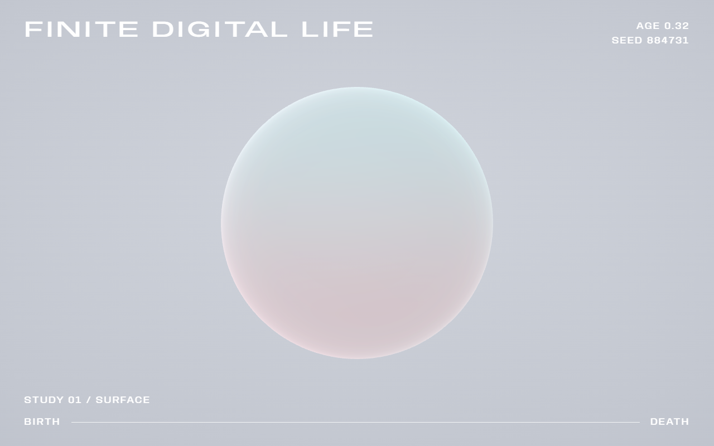

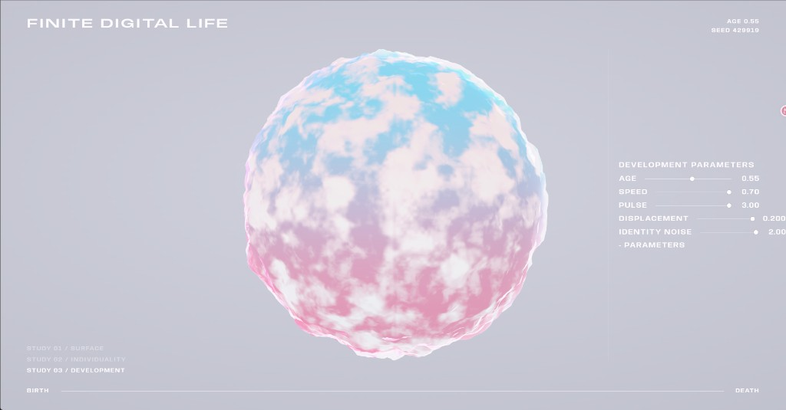

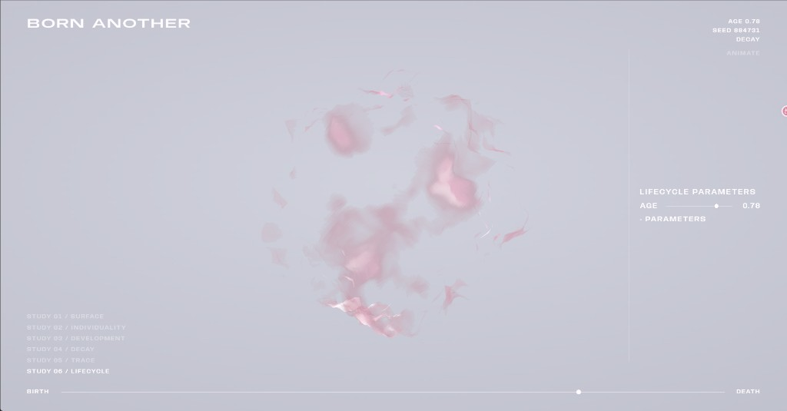

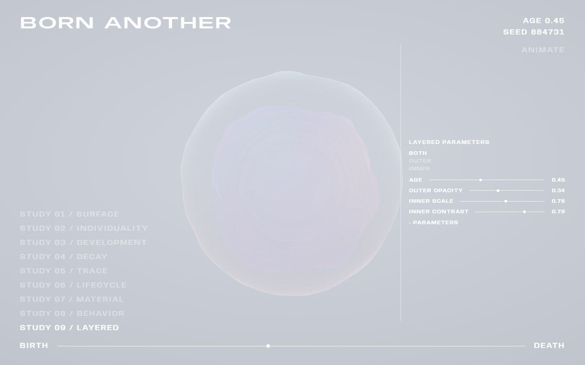

**Files:** `src/surfaceShader.js`, `src/surfaceParams.js`, `src/Specimen.jsx`, `src/App.jsx`, `src/AdjustBar.jsx`, `src/Hud.jsx`

### Scatter — growths that belong to the membrane

Scatter samples the **unit sphere in rest space**, then deforms each instance with the same displace field as the body. Growths ride the living surface instead of floating in world space. Types: Membrane, Plume, Pod.

This is the Noise Lab lesson (a rest field driving 3D) applied to a closed organism.

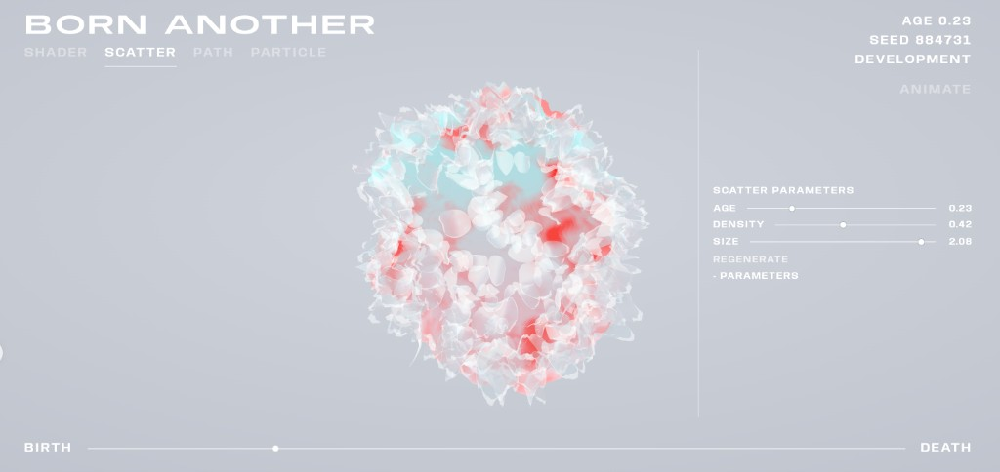

**Files:** `src/scatter/` — `ScatterField.jsx`, `sampleSurface.js`, `MembraneAsset.js`, `PlumeAsset.js`, `PodAsset.js`, `GrowthClusterAsset.js`

### Path — drawing as growth, not decoration

Strokes are drawn on the membrane in rest space. A closed stroke does not sit as a tube on top of the body; it **swells the surface along the trail**, so the organism’s form changes because of the mark.

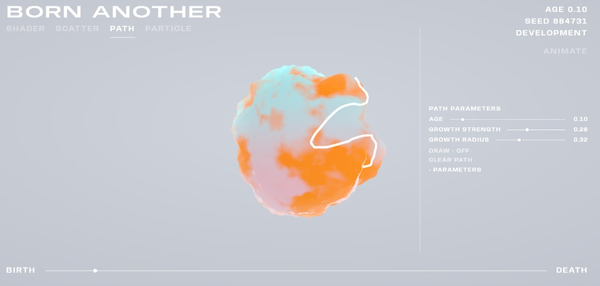

**Files:** `src/path/` — `PathField.jsx`, `pathSpline.js`, `pathGrowth.js`, `pathExtend.js`, `surfaceDisplace.js`

### Particle — a life field around the skin

Particles occupy a near-surface field: grit on the membrane, then volume, then vector currents and optional trails, all deformed with the host as AGE and breath run. They are a reading of the living surface, not a separate VFX pass.

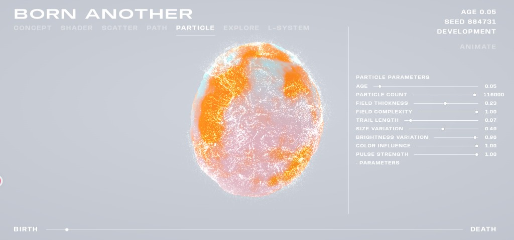

**Files:** `src/particle/` — `ParticleField.jsx`, `particleTrails.js`, `particleParams.js`

### Explore — camera as landscape scale

The same specimen, approached as a place rather than an object on a stand.

**Files:** `src/explore/`

### L-System — vascular grammar on the living surface

First a standalone 3D branching study, then a vascular web on the organism: hubs on the rest sphere, radial primaries, contact-aware stopping so territories do not cross, thickness hierarchy, GPU deformation with the body’s shader, AGE-driven growth and late fragmentation.

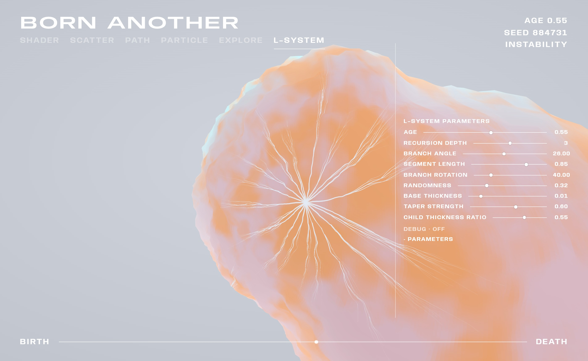

**Files:** `src/lsystem/` — `generateLSystem.js`, `attachLSystemToSurface.js`, `veinShader.js`, `LSystemField.jsx`, `lsystemLifecycle.js`

### Material — the same life, a different substance

A dedicated Studies tab (distinct from Shader Study 07). Geometry, AGE, seed, and Animate stay shared; only shading changes (core opacity, shell transmission, roughness, IOR, reflective glass).

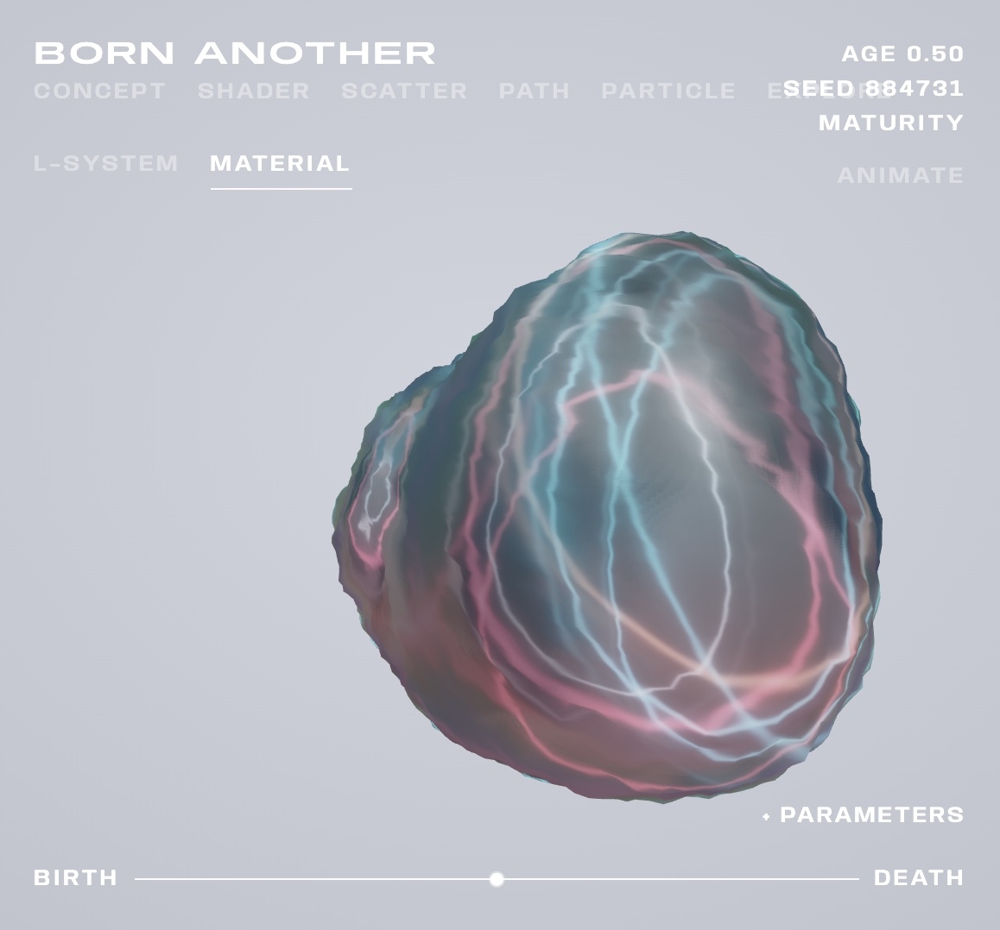

**Files:** `src/material/` — `organismMaterial.js`, `organismPhysicalMaterial.js`, shaders, `OrganismStudio.jsx`, `materialParams.js`

---

## Concept and System pages

The app is also a site, not only a lab.

- **Concept** (`src/concept/`) — Anybody type, Blade Runner still, written intent, lifecycle diagrams.
- **System** (`src/system/`) — how Studies and World relate; crystal-growth grammar.


**Also:** `src/SiteHeader.jsx`, `src/SiteHud.jsx`, `src/useAutoHideHeader.js`

---

## World V2 — the organism as a world

Studies keep the shader specimen. World is a separate scene: one seeded body you can orbit, enter, and fly through.

- Exterior and interior are the two sides of one surface.
- Fly camera: WASD, **Q/E elevate**, drag to look, scroll to dolly, R to reset.
- A **Life Engine** steps at 30 Hz through a 36-second life. AGE goes 0→1 and stops. Seed + intervention history + step replay the same state.
- The surface is a 48-region mineral field. Crossing a threshold nucleates a persistent site (maximum ten). A click records a stimulus that raises mineral over time; it does not spawn a crystal instantly.
- **Primary crystals** grow step-by-step from those sites: closed faceted prisms, roots under the membrane. Baked clusters remain as a visual fallback.

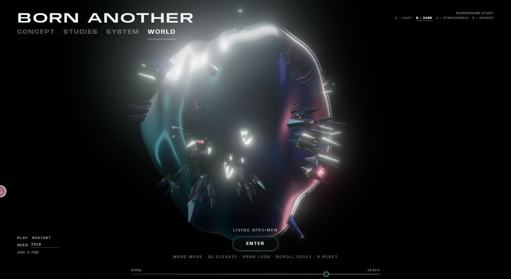

**Files:** `src/worldv2/WorldV2.jsx`, `worldGeometry.js`, `primaryCrystalGeometry.js`, `life/lifeEngine.js`, `life/worldLifeAdapter.js`, `life/useLifeEngine.js`, `life/*.test.js`

---

## Source map (this project)

```
Project03_Born-Another/src/
├── App.jsx, modes.js, main.jsx     Routing, shared AGE / seed, study Canvas
├── Specimen.jsx                    Shared living body
├── surfaceShader.js                GLSL form, decay, families, breath
├── surfaceParams.js                Study defaults
├── AdjustBar.jsx, Hud.jsx          Parameters and Studies HUD
├── SiteHeader.jsx, SiteHud.jsx     Site chrome
├── concept/  system/               Editorial pages
├── scatter/  path/  particle/
├── explore/  lsystem/  material/
└── worldv2/                        Scene + Life Engine + primary crystals
```

| File | Role |
| --- | --- |
| `src/App.jsx` | Mode hash, individuality, AGE playback, study Canvas |
| `src/modes.js` | Concept / Studies / System / World IDs |
| `src/Specimen.jsx` | Host mesh; optional organism material |
| `src/surfaceShader.js` | Macro morphology, micro breath, decay, trace |
| `src/path/surfaceDisplace.js` | CPU displace matching the shader |
| `worldv2/life/lifeEngine.js` | Fixed-step AGE, mineral, sites, crystal records |
| `worldv2/primaryCrystalGeometry.js` | Closed faceted hull |
| `worldv2/life/worldLifeAdapter.js` | Attach crystals to the deformed surface |

---

## Rules that keep the project coherent

1. The user sets conditions; the system grows form.
2. `uAge` is life. `uTime` is breath. They must not be mixed.
3. Seed locks identity across Studies.
4. Scatter, Path, Particle, and L-System veins store **rest-space** samples and deform with the host.
5. Material family changes *how* failure looks, not *when* the clock runs.
6. World and Studies share the concept, not the mesh.

---

## Midterm status

**Noise Lab — done.** Shared curl field; 2D / 3D / simulation / voxel; shaping and noise types; export; optional Firebase; terrain shader studies 01–06.

**Born Another — done through midterm.** Concept page; Shader Studies 01–09; Scatter, Path, Particle, Explore, L-System, Material on one life; System diagrams; World V2 with Life Engine, surface intervention, and primary crystal growth.

**Not yet.** Secondary crystal branching; lineage / memory inheritance across generations; unifying World and Studies into one simulation; a full preserve-moment archive.

---

## Written notes (optional)

The sections above are meant to stand alone. These files add dates, stills, and longer arguments:

| Document | Path |
| --- | --- |
| Course README (Noise Lab + Born Another) | [`../README.md`](../README.md) |
| Concept essay | [`../docs/concept/born-another-concept.md`](../docs/concept/born-another-concept.md) |
| Design decisions | [`../docs/planning/Born-Another-Planning-Steps.md`](../docs/planning/Born-Another-Planning-Steps.md) |
| Visual progress log | [`../docs/Progress-Recording/Born-Another.md`](../docs/Progress-Recording/Born-Another.md) |
| Shader studies (Noise Lab) | [`../docs/tutorials/Shader/02-shader-studies_noised_lab.md`](../docs/tutorials/Shader/02-shader-studies_noised_lab.md) |
| Shader studies (Born Another) | [`../docs/tutorials/Shader/03-born-another-shader-studies.md`](../docs/tutorials/Shader/03-born-another-shader-studies.md) |
| Screenshots | `../docs/assets/image/` |
