# Born Another

*A procedural world of lost and possible lives.*

Born Another is an underwater world of artificial lives. You don't sculpt them. You set the water they live in, and you can change it by speaking to it. Each life grows, takes on the shape of what it went through, crystallizes, dies and leaves remains on the sand. You choose which remains to keep. The kept ones go into an archive and a cavern under the dunes.

**[Live site → born-another.web.app](https://born-another.web.app)** *(to be updated: it currently shows an earlier build and will move to the final version at the same address)* · [Run it locally](#run-it-locally) · [Language interpreter](#the-language-interpreter) · [Past progress](#progress-recap)


<sub>World Final, `#world-final`. The descent: from the light at the surface down to the dunes, where three lives share one body of water.</sub>

---

## The piece: World Final

World Final (`#world-final`) is the finished work. The rest of the site shows how it was reached. It follows one chain from start to finish:

**Language → Environment → Form → Crystallization → Death & Remains → Archive**

and a cavern under the dunes at the end of it.

### 1 · Arrival

You descend into an underwater habitat of dunes, drifting veils, crystal outcrops and frost-crystal trees. Three lives share the water. You meet the central one young, at AGE 0.14, and it has about 3.7 minutes to live. New lives never pop into view: each one grows in from a small pearl bud.

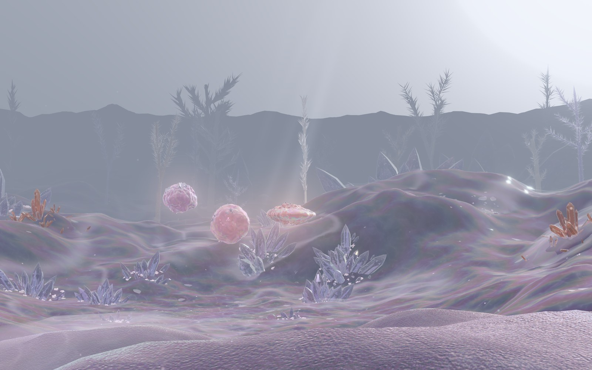
<sub>Arrival: three young lives over the dunes, with crystal outcrops, ember druses and frost-crystal trees around them.</sub>

### 2 · Language → Environment

You write to the water instead of moving sliders. An AI interpreter reads each message as a change in **temperature**, **moisture** and **turbulence**, along with an **intensity** and a **confidence**. "A cold, still night" and "a hot storm" push the water in different directions. A message can move each value by at most **±0.6** on top of the base settings, and the effect fades over time, so what you say works like weather rather than a permanent setting.

<!-- TODO (manual screenshot, Cmd+Shift+4): the language field with a typed sentence plus the environment panel showing the Δ readout. Save as docs/assets/image/final/02-language.png -->

<sub>A sentence is read as Δtemperature, Δmoisture and Δturbulence. Each change is capped at ±0.6 and then fades.</sub>

### 3 · Environment → Form

Each body records the water it lived in:

- **Warm** water raises ridges along the fibres. **Cold** water contracts the body.
- **Wet** water swells blisters and adds petals.
- **Turbulence** splits the body into bands.
- Every shift in the water leaves a mark that stays.

There are three species, each with its own sensitivities and morph logic: **spiral** (ammonite), **segmented** and **trilobite**. The same weather produces a different body in each.

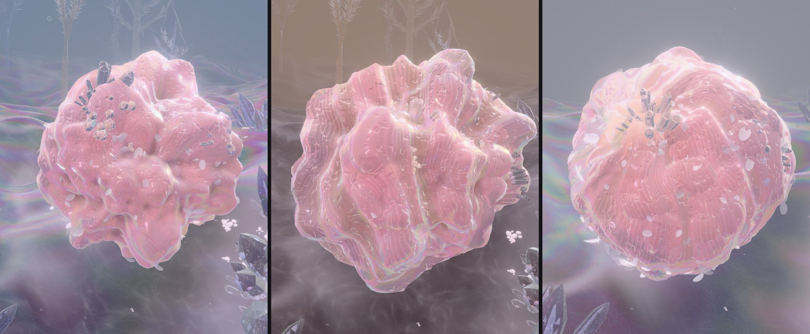
<sub>The same life as its water turns cold (left), warm (centre) and wet (right). Cold draws the body in, warmth raises ridges along the fibres, and wet water swells it and opens petals. The first crystals are already showing.</sub>

### 4 · Crystallization

As a life ages it turns to crystal. The target level is roughly **cold × wet × calm**, and dry water crystallizes faster.

- The **habit** depends on species: druse prisms, satin plates or iridescent blocks.
- The **cut** depends on the body's dominant shape: prism, faceted, stubby or tabular.
- The form **freezes** somewhere between 35% and 60% of the crystallization level. After that the shape no longer changes.

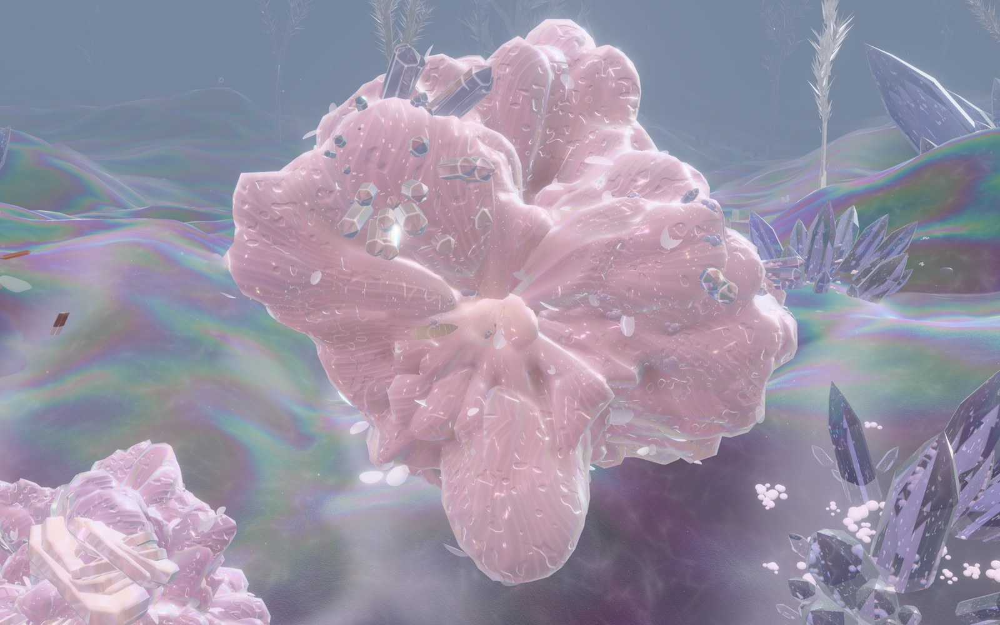
<sub>Late in life, in cold, wet, calm water: the body has unfolded and its crystals are setting.</sub>

<!-- TODO (manual): export the "Language → Environment → Crystallization" mapping sheet (Design artifact) as an image. Save as docs/assets/image/final/04-mapping-sheet.png -->

<sub>The full mapping on one sheet: what language changes in the water, and what the water changes in the body and its crystal.</sub>

### 5 · Death, remains and the Archive

At death the body stops changing shape. It sinks, settles on the sand and petrifies. Then the remains are **identified**: a card names the real extinct creature whose form this life followed (an ammonite, a trilobite…), when it appeared and vanished, and why. You can keep the remains: they are given a name and saved to the **Life Archive** in your browser (`#archive`). Each kept life gets its own card at `#archive/<key>`.

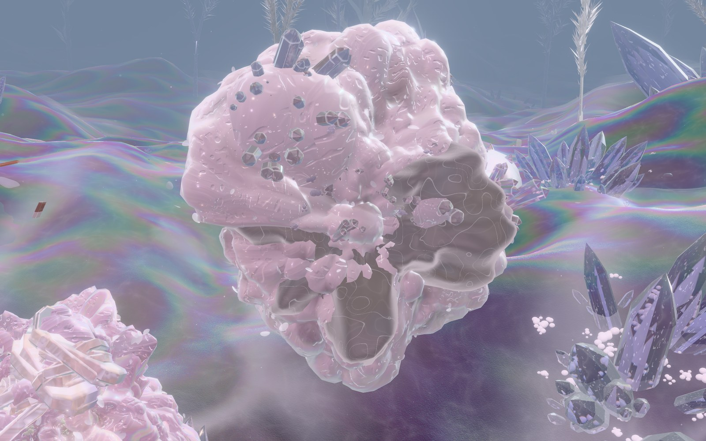
<sub>The moment after death: the water darkens and the body, now frozen in its last form, turns to stone. This one was identified as an ammonite.</sub>

<!-- TODO (manual screenshot): the matching Archive card. Save as docs/assets/image/final/05-archive-card.png -->


<sub>The same life in the Archive: its name, its record and a cut-out of its remains.</sub>

### 6 · The Underworld

A hole in the dunes leads down into a dark, iridescent cavern. Light from the hole falls as a pool on the floor. Lilac quartz and amber ember druses grow from the floor, walls and ceiling. The remains you kept are shown here as cut-out images. Walk toward one and a thin white leader line draws out to a small tag that links to its Archive card.

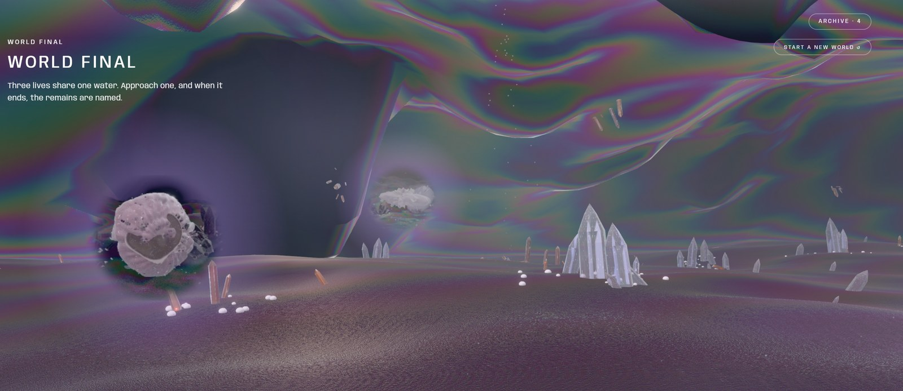
<sub>Under the dunes: two kept lives rest as cut-outs under the iridescent cavern roof, among lilac quartz clusters and amber ember druses.</sub>

### 7 · A world that keeps going

The world keeps running while you visit other pages of the site. It restarts only when you press **Start a new world ↺** and confirm. Reloading the page also starts it over. Kept remains stay in the Archive either way.

| You… | The world… |
|---|---|
| write a sentence | shifts temperature, moisture and turbulence by up to ±0.6, then lets them fade |
| keep the water cold, wet and calm | crystallizes the life further |
| change the water while the life is young | leaves marks on its body that stay |
| wait | the life freezes, dies and sinks to the sand |
| keep its remains | names them and adds them to the Archive and the cavern |

---

## The rest of the site

The site is organised as an exhibition. World Final is the main work, and the other sections show how it was made.

| Section | Address | What you'll find |
|---|---|---|
| Concept | `#concept` | The statement of intent: artificial life with a built-in end |
| Studies | `#shader` `#scatter` `#path` `#particle` `#explore` `#lsystem` `#material` | Technical studies, all run on one shared organism |
| System | `#system` | Architecture and crystal-growth diagrams |
| World | `#world` | World V2: the organism as an explorable world, driven by the Life Engine |
| Playground | `#playground` | Experiments 01–07, the route to World Final |
| **World Final** | `#world-final` | **The final piece** |
| Memory Lab | `#memory-lab` | A memory text turned into a signature that sets world parameters |
| Archive | `#archive`, `#archive/<key>` | The Life Archive of kept remains |

The Playground experiments, in order:

1. **Language as Environment**: can language change the conditions a life grows in?
2. **Independent Life B**: two lives with their own clocks in one scene
3. **Morphology Lab**: flattened, spiral and segmented rest shapes
4. **Final Form Lab**: the body's look and material
5. **Agent Behaviors**: crystal agents growing on the membrane
6. **Crystal Form Lab**: cold, moisture, warmth and turbulence acting on crystal growth
7. **Final Habitat**: the version that became World Final

---

## Run it locally

You need Node.js (a current LTS release) and npm.

```bash
cd Project03_Born-Another
npm install
npm run dev
```

The dev server runs at **http://127.0.0.1:5173**. It binds to IPv4 on purpose, because on some Windows setups `localhost` resolves to an address the server isn't listening on.

| Page | Local address |
|---|---|
| Concept | http://127.0.0.1:5173/#concept |
| Studies | http://127.0.0.1:5173/#shader (also `#scatter`, `#path`, `#particle`, `#explore`, `#lsystem`, `#material`) |
| System | http://127.0.0.1:5173/#system |
| World V2 | http://127.0.0.1:5173/#world |
| Playground | http://127.0.0.1:5173/#playground |
| **World Final** | **http://127.0.0.1:5173/#world-final** |
| Memory Lab | http://127.0.0.1:5173/#memory-lab |
| Archive | http://127.0.0.1:5173/#archive (one life: `#archive/<key>`) |

Other scripts:

```bash
npm run build     # production build into dist/
npm run preview   # serve dist/ locally (the interpreter route works here too)
npm run lint      # oxlint
```

### Tests

Tests use Node's built-in test runner, so there is nothing extra to install.

```bash
# World Final systems: body, crystals, terrain, caves, kin, remains, archive (58 tests)
node --test src/playground/finalHabitat/*.test.js

# Language interpreter
node --test server/interpret/*.test.js

# Everything
node --test $(find src server -name '*.test.js')
```

---

## The language interpreter

The interpreter runs only on the server. `server/interpret` is mounted into Vite by `server/vitePlugin.js` at `/api/interpret`, for both `npm run dev` and `npm run preview`. The browser sends text to that route and gets an interpretation back. **API keys never reach the browser.**

If the route can't be reached (for example on static hosting), times out or fails, the client switches to an offline, rule-based parser, so the world still responds to language.

### Setup

```bash
cp .env.example .env.local
```

Open `.env.local`, choose a provider, fill in the key for that provider only, and restart `npm run dev`. The terminal shows which provider and model are active, and says when it is using a fallback.

| Variable | What it does |
|---|---|
| `BA_AI_PROVIDER` | `openai`, `anthropic`, `gemini`, `mock` or `local` |
| `BA_AI_MODEL` | Model id. Leave empty to use the provider's default (listed in `.env.example`) |
| `OPENAI_API_KEY` / `ANTHROPIC_API_KEY` / `GEMINI_API_KEY` | Only the key for the chosen provider is needed |
| `BA_AI_TIMEOUT_MS` | Request timeout (default `8000`) |
| `BA_AI_MAX_INPUT_CHARS` | Longest message accepted (default `500`) |
| `BA_AI_FALLBACK` | What to use when the provider fails: `local` (rule-based parser) or `neutral` (no change) |
| `BA_AI_REASONING_EFFORT` | Optional, OpenAI reasoning models only |

Two providers don't need a key:

- **`mock`** returns fixed answers for the test sentences. It uses no network and costs nothing.
- **`local`** uses the rule-based keyword parser and works offline.

> [!IMPORTANT]
> **Keep keys out of the repository.**
> - Put API keys **only** in `.env.local`. It is git-ignored, and so is every `.env.*` file except `.env.example`.
> - **Never prefix a key with `VITE_`.** Vite bundles `VITE_*` variables into the browser, where anyone can read them.
> - **Never put a real key in `.env.example`**, in this README or anywhere else that gets committed. `.env.example` keeps the key lines empty (`OPENAI_API_KEY=`).

---

## How it's built

React 19 · @react-three/fiber 9 · drei 10 · three r186 · Vite 8 · oxlint · Firebase Hosting (serves `dist/` with an SPA rewrite). Routing is hash-based (`src/modes.js`, `src/App.jsx`).

World Final is `src/worldFinal/WorldFinalPage.jsx`, which renders `src/playground/Experiment07.jsx` and the systems in `src/playground/finalHabitat/`:

| Area | Files |
|---|---|
| Body, morphs, crystals | `CrystalBody.jsx`, `unfoldForm.js`, `crystalShapes.js`, `habitatShaders.js` |
| Terrain | `habitatField.js`, `habitatTerrainBuild.js`, `HabitatTerrain.jsx` |
| Ground growths | `habitatGrowthBuild.js`, `emberCrystals.js`, `HabitatGrowth.jsx` |
| Crystal trees | `crystalSpires.js`, `CrystalSpires.jsx` |
| Underworld | `caves.js`, `caveGeometry.js`, `Caves.jsx` |
| Other lives (kin) | `habitatKin.js`, `useHabitatKin.js`, `HabitatKin.jsx` |
| Death, remains, archive | `habitatFossil.js`, `Remains.jsx`, `archive.js`, `lifeLog.js`, `snapshotCutout.js` |
| Scene, light, opening | `HabitatScene.jsx`, `FocusStudio.jsx`, `HabitatAtmosphere.jsx`, `worldOpening.js` |

```
Project03_Born-Another/
├── server/
│   ├── vitePlugin.js            /api/interpret route (dev + preview)
│   └── interpret/               providers, prompt, schema, config
├── src/
│   ├── App.jsx, modes.js        hash routing, shared AGE / seed
│   ├── concept/  system/        editorial pages
│   ├── scatter/ path/ particle/ explore/ lsystem/ material/   Studies
│   ├── worldv2/                 World V2 + Life Engine
│   ├── playground/              Experiments 01–07
│   │   └── finalHabitat/        World Final systems
│   ├── worldFinal/              World Final page
│   ├── memoryLab/               Memory Lab
│   └── archive/                 Life Archive pages
└── .env.example                 interpreter settings, no keys
```

---

## Course context

Born Another is **Project 03** for **MC2994 Procedural World Building** (Cornell, Fall 2026).

It follows **[Noise Lab](../Project02)** (Project 02). Noise Lab treated one curl-noise field as an instrument and read it as a map, a terrain, a simulation and a voxel volume. Born Another keeps that idea of one procedural field read in many ways, but changes what the viewer is doing. In Noise Lab you kept adjusting a terrain you owned. Here you look after lives that will end. The overview of the whole course repository is in the [course README](../README.md).

---

## Progress recap

These are the stages that led to World Final. Each one links to its progress log.

### Concept: life with a built-in end
The starting point was the replicant condition in *Blade Runner* (1982): artificial life with a designed end. The questions were when something born from inherited information becomes itself, and which moments of a life designed to disappear are worth keeping.
→ [Concept essay](../docs/concept/born-another-concept.md) · [Concept notes](../docs/concept/BORN_ANOTHER_Concept.md) · [References](../docs/concept/project_reference.md)


<sub>From film to principles: themes from <i>Blade Runner</i> turned into a procedural organism, a finite life cycle, persistent memory and preserving the moment.</sub>

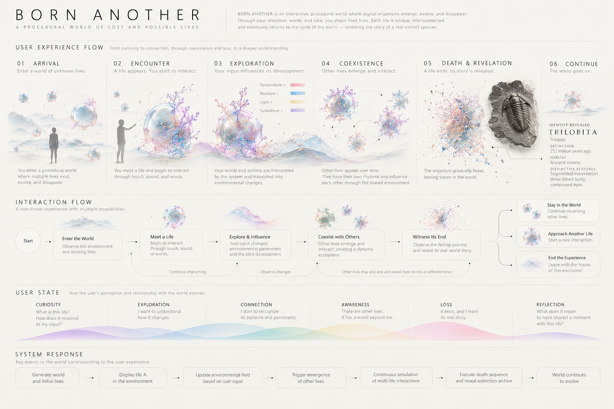
<sub>The planned experience: arrival, encounter, exploration, coexistence, death and revelation, and a world that continues. World Final carries this plan out.</sub>

### Studies: one organism, many questions (Sept – Oct)
Shader Studies 01–09 took one sphere from membrane to individual, development, decay and trace. Scatter, Path, Particle, L-System and Material then asked new questions of the same life, all locked to one seed and one AGE clock.
→ [Visual progress log: Shader, Scatter, Spline, Particle, L-System, Material](../docs/Progress-Recording/Born-Another.md) · [Shader studies tutorial](../docs/tutorials/Shader/03-born-another-shader-studies.md)

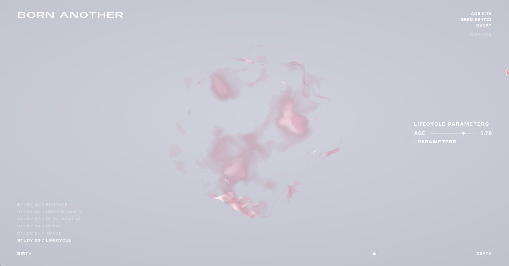
<sub>Shader Study 06: decay runs through the material and the mesh instead of a global fade.</sub>

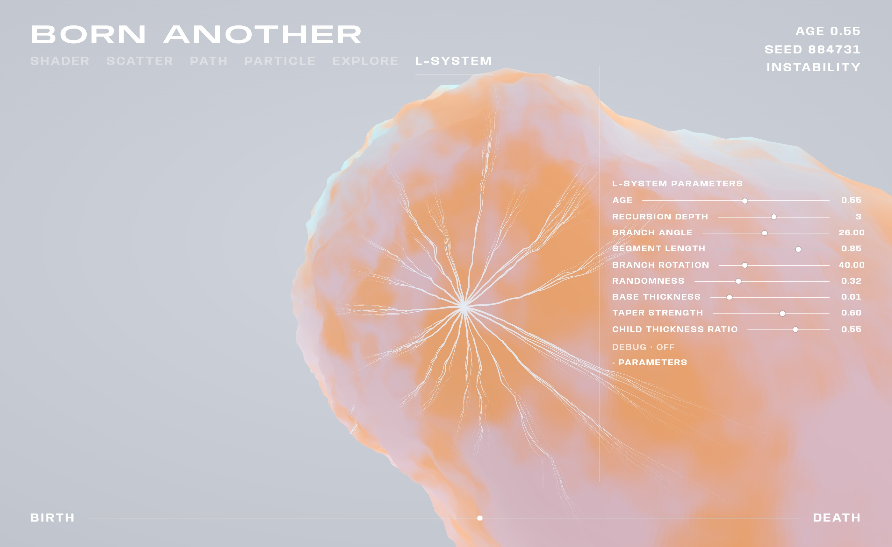
<sub>L-System: a vascular web attached to the living surface, growing and breaking up with AGE.</sub>

### System: how the parts fit
The System page sets out how Studies and World relate, and the grammar for crystal growth.
→ [Planning steps](../docs/planning/Born-Another-Planning-Steps.md) · [Technical log](../docs/planning/Born-Another-Technic-Log.md) · [Website organization](../docs/planning/Website-Organization.md)

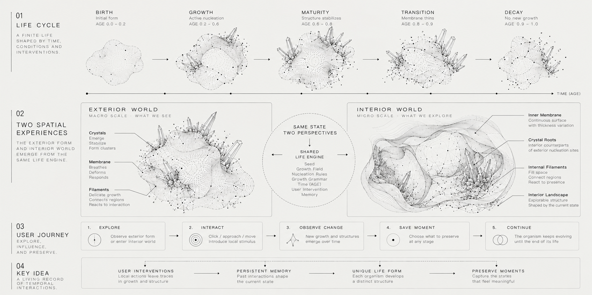
<sub>One Life Engine and two views of it: the exterior form and the interior landscape, across birth, growth, maturity, transition and decay.</sub>


<sub>The proposed care-and-consequence loop: observe, act, see the immediate response, then the long-term effects, until death and preservation.</sub>

### World V2: the organism as a world (midterm)
A body you can orbit, enter and fly through. A deterministic Life Engine runs a 36-second life at 30 Hz. Touching the surface raises mineral levels over time, and primary crystals grow from the sites that cross a threshold.
→ [World V2 section of the progress log](../docs/Progress-Recording/Born-Another.md#born-another--world-v2) · [Midterm feedback](../docs/planning/BORN%20ANOTHER%20%E2%80%94%20Midterm%20Feedback%20Summary.md)

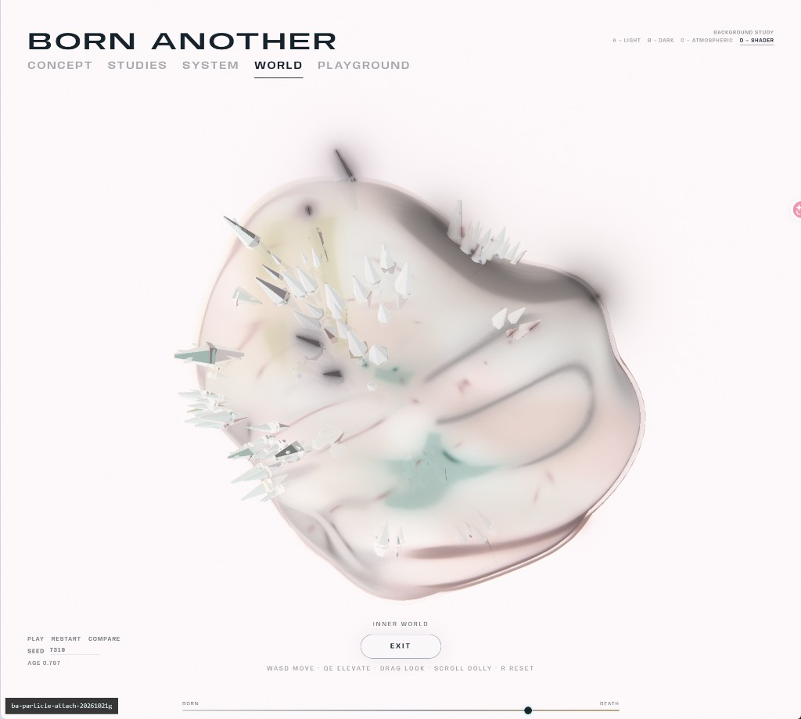
<sub>World V2, shader background: primary crystals grown from surface sites late in life (AGE 0.77).</sub>

### Playground: the route to World Final (Oct – Nov)
Seven isolated experiments tested the final piece one idea at a time: language as weather, a second independent life, rest shapes, body material, crystal agents and crystal form. Experiment 07 combined them into the habitat that became World Final.
→ [Playground progress log](../docs/Progress-Recording/Born-Another_Playground.md)

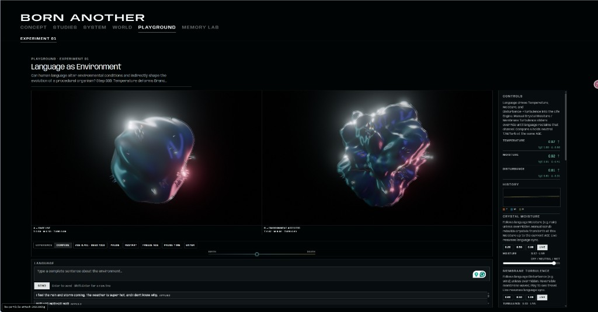
<sub>Experiment 01, Language as Environment: typed sentences drive temperature, moisture and turbulence in the Life Engine, shown with an A/B comparison.</sub>

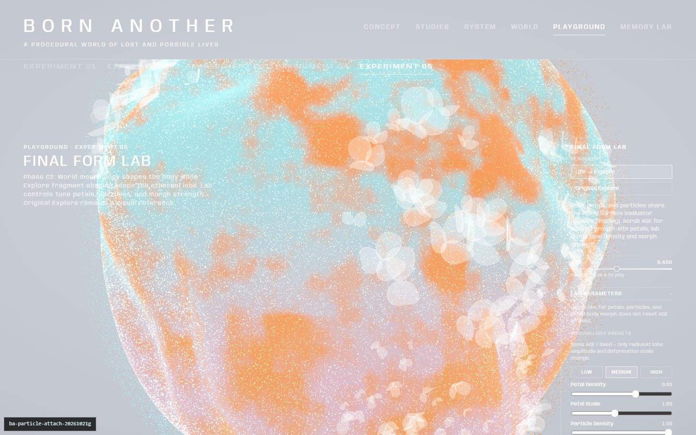
<sub>Experiment 05, Final Form Lab: the body with its petals and particle field, before the move under water.</sub>

### Other notes

| Document | Link |
|---|---|
| Course README (Noise Lab + Born Another) | [../README.md](../README.md) |
| Shader studies (Noise Lab) | [02-shader-studies_noised_lab.md](../docs/tutorials/Shader/02-shader-studies_noised_lab.md) |
| World build guide | [World Build Guide (three.js)](../docs/planning/Born%20Another%20%E2%80%94%20World%20Build%20Guide%20%28three.js%29.md) |
| All screenshots | `../docs/assets/image/` |
