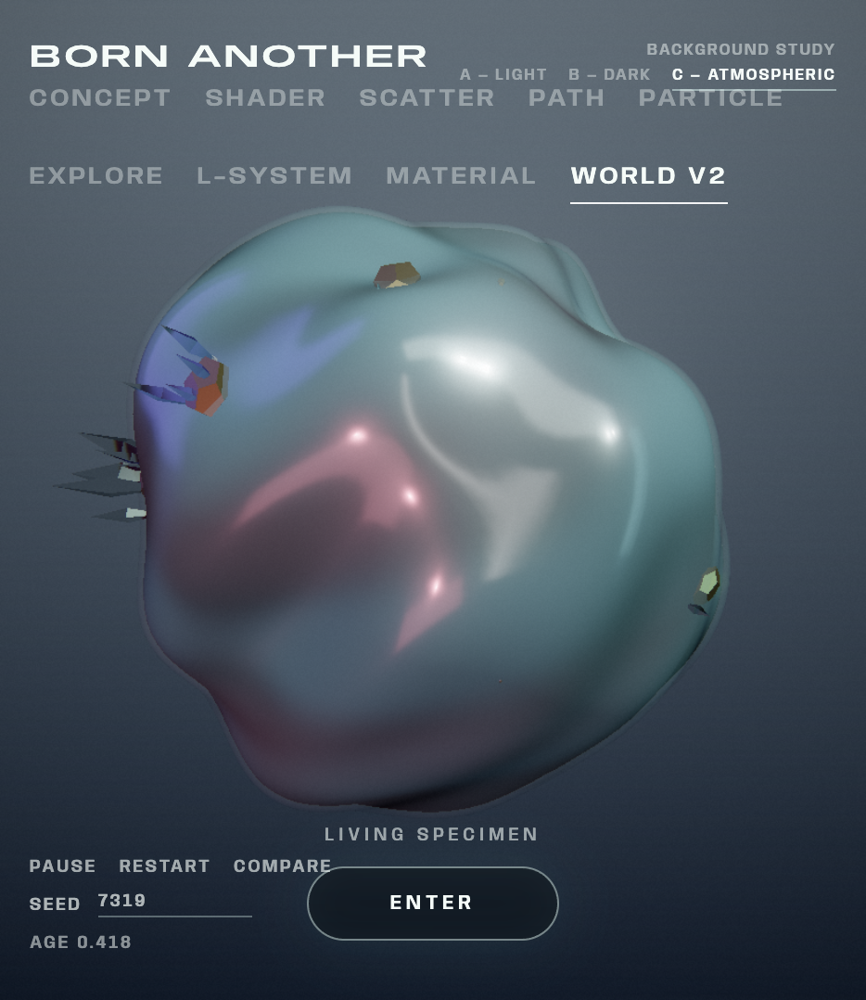

# MC2994 Procedural World Building

Course folder for **MC2994 / DESIGN 4197 — Procedural World Building**, from the start of the semester through midterm (September–mid-October 2026).

This repository is not a single app. It records how the work moved from **noise as an instrument** to **life as a finite procedural system**.

1. **Noise Lab** (`Project02`) — a shared curl-noise field that drives a 2D map, a 3D heightfield, simulations, and a voxel volume. The question is: *if one field is the source of truth, what can it generate?*
2. **Born Another** (`Project03_Born-Another`) — a finite artificial life. The user sets conditions; the entity develops, dies, and can leave a trace. The question is: *if something is designed to disappear, which moment is worth remembering?*

A short early sketch (`Project01`) and the written notes (`docs/`) sit beside those two projects. The sections below describe what each part actually does, so the folder can be read without opening every linked file.

---

## What’s in this folder

```
mc2994/
├── Project01/                     Early React + Three.js sketch (layered generative planes)
├── Project02/                     Noise Lab — curl-noise instrument
├── Project03_Born-Another/        Born Another — finite procedural life
├── docs/
│   ├── concept/                   Project intent (Born Another)
│   ├── planning/                  Design decisions, Voxel / Firebase prompts
│   ├── Progress-Recording/        Visual diary for Born Another
│   ├── tutorials/                 Shader, Voxel, Firebase, React, class notes
│   └── assets/image/              Progress screenshots
├── STYLE-GUIDE.md                 Noise Lab UI language (black field, typeset controls)
└── README.md                      This file
```

| Path | What it is |
| --- | --- |
| `Project01/` | First Vite + React + R3F scene: stacked generative planes and a control bar. A setup sketch, not the main project. |
| `Project02/` | **Noise Lab.** Shared 2D field → 3D terrain, wind / particle / erosion sims, voxel volume, Firebase save/load. |
| `Project03_Born-Another/` | **Born Another.** Concept / Studies / System / World. Shader studies, scatter, path, particle, L-system, material, Life Engine. |
| `docs/` | Concept writing, planning, tutorials, and the screenshot log. |
| `STYLE-GUIDE.md` | Editorial UI rules written for Noise Lab (poster-like black/white interface). |

Optional notes live in `docs/`. They add dates, prompts, and extra stills. They are not required to understand what the code is doing.

---

## How to run

**Noise Lab**

```bash
cd Project02
npm install
npm run dev
```

Then `#/` home, `#/2d` map, `#/3d` terrain, `#/sim` simulation, `#/voxel` volume.

**Born Another**

```bash
cd Project03_Born-Another
npm install
npm run dev
```

Then `#concept`, `#shader` (and the other Studies hashes), `#system`, `#world`.

---

# Part 1 — Noise Lab

**Location:** `Project02/`

Noise Lab is a **curl-noise instrument**. One 2D field is generated from noise; that same field is sampled as a height map, as flow, as a simulation domain, and later as a density volume. The interface is a technical poster: black field, white type, sparse gold accent (`STYLE-GUIDE.md`).

### What was being researched

The first half of the semester treated procedural form as a **map**, not as a finished object.

- **Noise as a function of position**, not a painted texture. Simplex, Perlin, Worley, value noise, and FBM are interchangeable sources for the same pipeline.
- **Shaping** after the sample: power, bias, gain, clamp, absolute, smoothstep, sine. The raw field is remapped so ridges, terraces, or cells can appear without writing a new noise type.
- **Curl of a scalar potential.** A 2D potential \(\psi\) is sampled; finite differences give \((\partial\psi/\partial y,\; -\partial\psi/\partial x)\). The result is a divergence-free flow that can be drawn as arrows and used as wind or particle advection.
- **One field, several readings.** Height is a blend of curl magnitude and remapped potential. The 2D viewport, the 3D mesh, and the simulation all read the same arrays (`vx`, `vy`, `height`). Changing SCALE, OCTAVES, STRENGTH, or EVOLVE updates every view together.
- **Simulation on the field**, not a separate world: wind (the field evolving in time), particles advected by curl, raindrop erosion that carves the height.
- **Volume versus heightfield.** A height map cannot make caves or overhangs. The Voxel tab samples a 3D density function and meshes it, so the same course ideas (noise, threshold, CSG) move from a surface into a solid.
- **Shaders as a way of seeing.** Before Born Another, shader studies on the Noise Lab terrain practiced flat color, height gradients, interpolation, slope, Fresnel, and GPU vertex displacement — the same GLSL habits later used on a living membrane.

### What the app actually does

| Route | Role |
| --- | --- |
| `#/` **Home** | Title field. “A shared 2D field drives the map, the terrain, and the simulation.” |
| `#/2d` **2D MAP** | Grid of the field: magnitude, potential, flow ticks. Equation panel for the current noise. Shared sliders: SCALE, OCTAVES, STRENGTH, EVOLVE, RES, shaping OP + amount, noise type. |
| `#/3d` **3D WORLD** | The same map bilinear-sampled onto a plane: vertical displace plus a little lateral curl. Display modes SOLID / WIREFRAME / SOLID + WIREFRAME. A floating 2D map can sit over the 3D view. GRID HEIGHT and SIZE apply here. |
| `#/sim` **SIMULATION** | Three modes on the same field. **Wind** — evolve the potential over time. **Particles** — points follow curl; optional trails and a 2D/3D view. **Erosion** — raindrops carve a copy of the height. Start / pause / reset; the noise parameters remain live. |
| `#/voxel` **VOXEL** | Independent density lab: grid size, threshold, FBM scale, density modes (ground, island, planet, …), CSG presets, meshing. Not driven by the curl heightfield on purpose — volume and surface stay separately tunable. |

Also built:

- **Export** of the terrain as PNG / OBJ / GLTF / GLB (`src/export/exportTerrain.js`).
- **Firebase** (optional): email/password auth, Firestore save/load of the parameter set, Storage for exported files, owner-only rules. Runtime fields (typed arrays, particles, rain) are *not* saved; they are rebuilt from settings.

### Noise Lab file map

| Path | Role |
| --- | --- |
| `Project02/src/App.jsx` | Hash routing, shared params, noise-map generation, simulation loop, auth |
| `src/noise/generateNoiseMap.js` | FBM potential → shaping → curl → height |
| `src/noise/noiseTypes.js` | Simplex / Perlin / Worley / value / FBM |
| `src/noise/shaping.js` | Power, bias, gain, clamp, abs, smoothstep, sine |
| `src/noise/simplex2d.js`, `simplex3d.js` | Noise kernels |
| `src/pages/Map2DPage.jsx` | 2D instrument |
| `src/pages/Grid3DPage.jsx` | 3D heightfield |
| `src/pages/SimulationPage.jsx` | Wind / particle / erosion workspace |
| `src/pages/VoxelPage.jsx` | Density / CSG / mesh lab |
| `src/pages/HomePage.jsx` | Enter screen |
| `src/simulation/` | Particle system, raindrops, erosion height, rAF loop |
| `src/voxel/` | Density, chunks, CSG, meshers |
| `src/components/` | Control panel, maps, 3D scenes, auth, export menu |
| `src/export/exportTerrain.js` | Mesh / image download |
| `src/firebase.js`, `src/services/` | Auth and saved configs |
| `STYLE-GUIDE.md` (repo root) | Visual language for this app |

Shader practice for this project is written in `docs/tutorials/Shader/02-shader-studies_noised_lab.md` (Studies 01–06: uniform color, height gradient, interpolation, slope, Fresnel, vertex displacement). Voxel notes are in `docs/tutorials/Voxel/`. Firebase steps are in `docs/tutorials/Firebase_NoiseLab.md`.

### What carried into Born Another

Noise Lab taught the course habits that Born Another still uses:

- A **seeded / parameterized field** is the identity of the world, not a one-off mesh.
- **2D rest data** can drive 3D form (later: rest-space scatter, paths, and veins on a sphere).
- **Curl and particles** are readings of a field (later: near-surface life currents on the organism).
- **Shaders** color and displace from uniforms (`uTime`, height, normals) instead of baking a look.
- The UI can stay **editorial** (type and spacing, not dashboard chrome).

Noise Lab still generates a **world you keep adjusting**. Born Another changes the contract: the user no longer owns a terrain; they observe a life that will end.

---

# Part 2 — Born Another

**Location:** `Project03_Born-Another/`


### Concept

Most generative tools ask for a preferred output: set parameters, generate an object, keep the one you like.

Born Another treats the generated form as a **temporary entity**. The user chooses **initial conditions**. The system develops a body over a finite lifespan. Death is designed in from the start. The user cannot make the life permanent, but can watch it, stimulate it, and (in the concept) decide which moment is worth remembering.

The origin is the replicant condition in *Blade Runner* (1982): artificial life with a built-in end. The project does not copy the film’s look. It asks:

> If something begins from inherited information, when does it become itself?
> If an artificial life is designed to disappear, which moment of its existence is worth preserving?

The intended cycle is:

**Creation → Inheritance → Individuality → Life → Death → Memory → New Life**

A life reads as:

**Birth → Development → Maturity → Instability → Decay → Death → Trace**

Two ideas structure the whole project:

1. **Conditions, not sculpture.** Seed and stimulus matter more than vertex sculpting.
2. **Two clocks.** `uAge` (0→1) is mortality. `uTime` is breath and noise motion. Scrubbing age is not scrubbing a loop.

Through midterm, lineage across generations and a full “preserve this moment” archive are still conceptual. What *is* built is one repeatable individual (locked by seed), a complete birth-to-death clock, a trace after death, and a World in which intervention can change later crystal growth.

### How the site is organized

| Section | Hash | What you see |
| --- | --- | --- |
| **Concept** | `#concept` | Editorial statement, Blade Runner still, lifecycle diagrams |
| **Studies** | `#shader`, `#scatter`, `#path`, `#particle`, `#explore`, `#lsystem`, `#material` | One shared living specimen; each tab adds a system |
| **System** | `#system` | Architecture and crystal-growth grammar drawings |
| **World** | `#world` | Enterable organism-world with its own Life Engine |

`+ Parameters` opens sliders. **Animate** / Space runs AGE (~16 s in Studies). **Seed** locks which individual this is.

---

### Studies — what each one is for

Studies share one Canvas, one AGE clock, and one seed. They are not a gallery of unrelated demos. Each tab asks a different technical question of the **same life**.

#### Shader Studies 01–09 — one mesh, one life

A pale sphere on a cool gray field becomes a membrane, then an individual, then a developing body, then a failing one, then a residue.

| Study | Question | What it does |
| --- | --- | --- |
| **01 Surface** | How can a sphere read as matter rather than a shaded ball? | Vertical body gradient, Fresnel rim, translucency. No identity noise yet. |
| **02 Individuality** | What makes this one *this* one? | Seed-locked object-space noise markings. Geometry still a sphere; pattern is identity. |
| **03 Development** | How does form change over life? | AGE envelopes stretch pattern and color. Macro morphology bulges the silhouette. Micro displacement is breath (`uTime`), quieter at birth and late age. |
| **04 Decay** | How does it fail without fading as a whole? | A seed-locked discard field vs an age threshold: holes, thinning, late warp. Mortality is in the material and the mesh, not a dissolve slider. |
| **05 Trace** | What remains after death? | Frozen residue. Breathing stops. The leftover is a record of *that* seed, not a new object. |
| **06 Lifecycle** | Can one clock tell the whole story? | Animate from AGE 0 to 1. Death is irreversible until New Life. |
| **07 Material** | Same life, different substance? | Membrane / crystalline / hybrid families on the same aging pipeline. |
| **08 Behavior** | Does substance change *how* it dies? | Family bias on the same decay field — different failure character, same clock. |
| **09 Layered** | Can depth exist without nested shells? | One mesh: interior glow plus a foil-like fracture. Nested extra meshes were rejected so AGE cannot desync. |


**Code:** `src/surfaceShader.js` (GLSL), `src/surfaceParams.js` (defaults / families), `src/Specimen.jsx` (the body), `src/App.jsx` (AGE rAF, seed, routing), `src/AdjustBar.jsx`, `src/Hud.jsx`.

#### Scatter — growths that belong to the membrane

Scatter samples the **unit sphere in rest space**, then deforms each instance with the same displace field as the body. Growths ride the living surface instead of floating in world space. Types: **Membrane**, **Plume**, **Pod**.

This is the Noise Lab lesson (a 2D/rest field driving 3D) applied to a closed organism.


**Code:** `src/scatter/` — `ScatterField.jsx`, `sampleSurface.js`, `MembraneAsset.js`, `PlumeAsset.js`, `PodAsset.js`, `GrowthClusterAsset.js`.

#### Path — drawing as growth, not as decoration

The user draws strokes on the membrane in rest space. A closed stroke does not sit as a tube on top of the body; it **swells the surface along the trail** (a growth field), so the organism’s form changes because of the mark.


**Code:** `src/path/` — `PathField.jsx`, `pathSpline.js`, `pathGrowth.js`, `pathExtend.js`, `surfaceDisplace.js` (JS copy of the shader displace so CPU features stay glued).

#### Particle — a life field around the skin

Particles are not a separate VFX layer. They occupy a near-surface field: grit on the membrane, then volume, then vector currents and optional trails, all deformed with the host as AGE and breath run.


**Code:** `src/particle/` — `ParticleField.jsx`, `particleTrails.js`, `particleParams.js`.

#### Explore — camera as landscape scale

The same specimen, approached as a place rather than an object on a stand. Tests whether the body can hold a close camera.

**Code:** `src/explore/`.

#### L-System — vascular grammar on the living surface

First a standalone 3D branching study, then a **vascular web** on the organism: hubs on the rest sphere, radial primaries, contact-aware stopping so territories do not cross, thickness hierarchy, GPU deformation with the body’s shader, AGE-driven growth and late fragmentation.


**Code:** `src/lsystem/` — `generateLSystem.js`, `attachLSystemToSurface.js`, `veinShader.js`, `LSystemField.jsx`, `lsystemLifecycle.js`.

#### Material — the same life, a different substance

A dedicated Studies tab (not Shader Study 07). Geometry, AGE, seed, and Animate stay shared; only the surface shading changes (core opacity, shell transmission, roughness, IOR, reflective glass).


**Code:** `src/material/` — `organismMaterial.js`, `organismPhysicalMaterial.js`, shaders, `OrganismStudio.jsx`, `materialParams.js`.

---

### Concept and System pages

The app is also a site, not only a lab.

- **Concept** (`src/concept/`) — Anybody type, Blade Runner still, written intent, lifecycle diagrams.
- **System** (`src/system/`) — how Studies and World relate; crystal-growth grammar.


---

### World V2 — the organism as a world

Studies keep the shader specimen. **World** is a separate scene: one seeded body you can orbit, enter, and fly through.

- Exterior and interior are the two sides of one surface.
- Fly camera: WASD, **Q/E elevate**, drag to look, scroll to dolly, R to reset.
- A **Life Engine** steps at 30 Hz through a 36-second life. AGE goes 0→1 and stops. Seed + intervention history + step replay the same state.
- The surface is a 48-region mineral field. Crossing a threshold nucleates a persistent site (max 10). A click records a stimulus that raises mineral over time; it does not spawn a crystal instantly.
- **Primary crystals** grow step-by-step from those sites: closed faceted prisms, roots under the membrane. Baked clusters remain as a visual fallback.



**Code:** `src/worldv2/WorldV2.jsx`, `worldGeometry.js`, `primaryCrystalGeometry.js`, `life/lifeEngine.js`, `life/worldLifeAdapter.js`, `life/useLifeEngine.js`, plus `life/*.test.js`.

---

### Born Another source map

```
Project03_Born-Another/src/
├── App.jsx, modes.js, main.jsx     Routing, shared AGE / seed, study Canvas
├── Specimen.jsx                    Shared living body
├── surfaceShader.js                GLSL form, decay, families, breath
├── surfaceParams.js                Study defaults
├── AdjustBar.jsx, Hud.jsx          Parameters and Studies HUD
├── SiteHeader.jsx, SiteHud.jsx     Site chrome
├── concept/  system/               Editorial pages
├── scatter/  path/  particle/
├── explore/  lsystem/  material/
└── worldv2/                        Scene + Life Engine + primary crystals
```

| File | Role |
| --- | --- |
| `src/App.jsx` | Mode hash, individuality, AGE playback, study Canvas |
| `src/modes.js` | Concept / Studies / System / World IDs |
| `src/Specimen.jsx` | Host mesh; optional organism material |
| `src/surfaceShader.js` | Macro morphology, micro breath, decay, trace |
| `src/path/surfaceDisplace.js` | CPU displace matching the shader |
| `worldv2/life/lifeEngine.js` | Fixed-step AGE, mineral, sites, crystal records |
| `worldv2/primaryCrystalGeometry.js` | Closed faceted hull |
| `worldv2/life/worldLifeAdapter.js` | Attach crystals to the deformed surface |

---

### Rules that keep the project coherent

1. The user sets conditions; the system grows form.
2. `uAge` is life. `uTime` is breath. They must not be mixed.
3. Seed locks identity across Studies.
4. Scatter, Path, Particle, and L-System veins store **rest-space** samples and deform with the host. They do not bake world positions.
5. Material family changes *how* failure looks, not *when* the clock runs.
6. World and Studies share the concept, not the mesh.

---

## Midterm status

**Noise Lab (done)**  
Shared curl field, 2D/3D views, shaping and noise types, wind / particle / erosion, voxel density lab, export, optional Firebase, shader studies 01–06 on terrain.

**Born Another (done through midterm)**  
Concept writing and editorial page; Shader Studies 01–09; Scatter, Path, Particle, Explore, L-System, Material on one life; System diagrams; World V2 with Life Engine, surface intervention, and primary crystal growth.

**Not yet (after midterm)**  
Secondary crystal branching; lineage / memory inheritance across generations; unifying World and Studies into one simulation; a full preserve-moment archive.

---

## Written notes (optional)

These expand dates and stills. The narrative above does not depend on them.

| Document | Path |
| --- | --- |
| Born Another concept | [`docs/concept/born-another-concept.md`](docs/concept/born-another-concept.md) |
| Design decisions | [`docs/planning/Born-Another-Planning-Steps.md`](docs/planning/Born-Another-Planning-Steps.md) |
| Visual progress log | [`docs/Progress-Recording/Born-Another.md`](docs/Progress-Recording/Born-Another.md) |
| Shader studies (Noise Lab) | [`docs/tutorials/Shader/02-shader-studies_noised_lab.md`](docs/tutorials/Shader/02-shader-studies_noised_lab.md) |
| Shader studies (Born Another) | [`docs/tutorials/Shader/03-born-another-shader-studies.md`](docs/tutorials/Shader/03-born-another-shader-studies.md) |
| Voxel | [`docs/tutorials/Voxel/`](docs/tutorials/Voxel/) |
| Firebase | [`docs/tutorials/Firebase_NoiseLab.md`](docs/tutorials/Firebase_NoiseLab.md) |
| Project README (Born Another, same story + file tables) | [`Project03_Born-Another/README.md`](Project03_Born-Another/README.md) |
