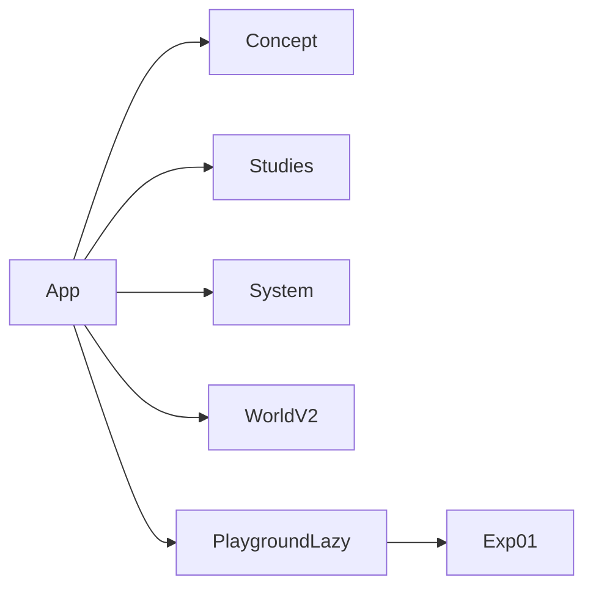

# Website Organization — Playground Mode Framework

Plan for adding a top-level **Playground** section to Born Another for quick final-project prototyping. Structural / UI-only; no changes to World V2, Studies algorithms, or simulation parameters.

**Overview:** Add `#playground` that reuses SiteHeader / SiteHud and Studies-style tabs, with a self-contained experiment registry and an empty Experiment 01 placeholder — no Canvas, no World/Studies changes.

---

## 1. Reuse

- **Nav:** `SiteHeader.jsx` + `MODES` in `modes.js` (auto-renders the new tab)
- **Header band:** `SiteHud.jsx` + `useAutoHideHeader` (same pattern as Concept / System)
- **Experiment tabs:** Study tab classes from `index.css` (`.hud-study-modes` / `.hud-study-mode-item`) with System-page dark-on-light overrides
- **Page chrome / type:** Mirror `system/system.css` palette (`#f0f0ee` / `#171817`), margins, numbered labels, hairline dividers — no new design system

---

## 2. Files

**Create**

| File | Role |
|------|------|
| `src/playground/experiments.js` | Registry (`id`, `label`, `title`, `description`) |
| `src/playground/Experiment01.jsx` | Empty placeholder (title, description, scene slot, controls slot; no R3F) |
| `src/playground/PlaygroundPage.jsx` | Layout + experiment tablist + active experiment only |
| `src/playground/playground.css` | System-like page styles + dark tab underlines |
| `src/playground/index.js` | Public export |

**Modify**

| File | Change |
|------|--------|
| `modes.js` | Add Playground to `MODES`; parse / hash `#playground` |
| `App.jsx` | Early return for playground (like concept/system); `React.lazy` + `Suspense` |

**Do not touch:** World V2, Studies canvas path, shaders, life engine, AdjustBar study state.

---

## 3. Experiment registration and switching

- `experiments.js` exports `PLAYGROUND_EXPERIMENTS[]`
- `PlaygroundPage` keeps `activeId` in local `useState`
- Only the matching Experiment component mounts
- Adding Experiment 02 later = new file + one registry entry; no App.jsx experiment state
- v1 routing: `#playground` only; in-page tabs switch experiments (sub-hash can come later)

---

## 4. Isolation from World V2

- App mounts Playground **instead of** Studies/World (early `if (modeId === 'playground')`)
- No `WebGLCanvas`, Specimen, or WorldV2 imports inside playground
- Experiment state stays inside `PlaygroundPage` / experiment components

---

## 5. Implementation steps

1. Extend `MODES` + routing for playground
2. Build playground module (registry, Exp01 placeholder, page, CSS)
3. Wire lazy early-return in `App.jsx`
4. Run production build; confirm existing mode branches unchanged

---

## Constraints

- Load Playground-specific code only when the mode is active (lazy import)
- Do not initialize inactive experiments
- Do not mount a Three.js Canvas in the empty placeholder
- Keep existing modes and study tabs unchanged
